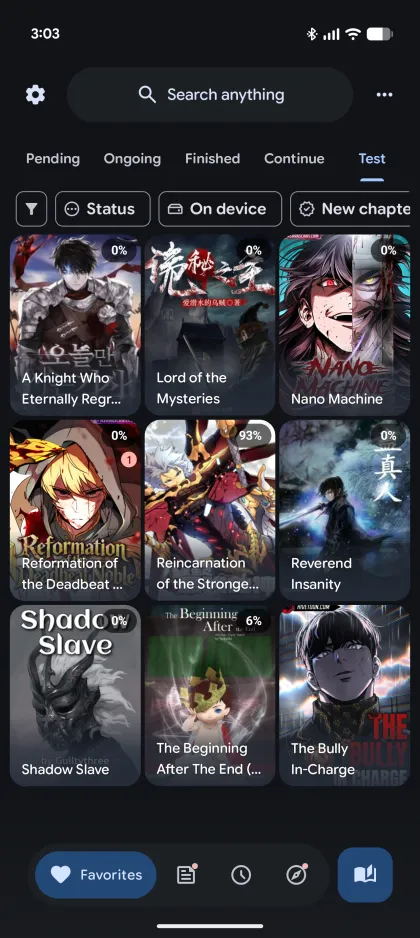
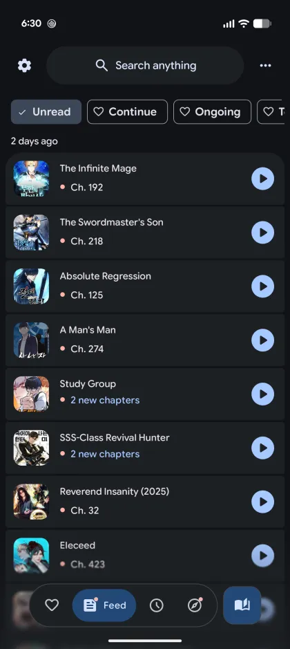
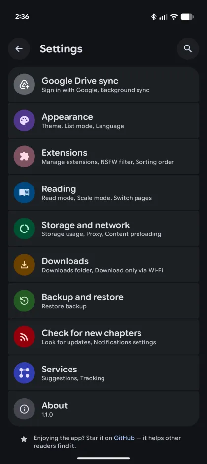
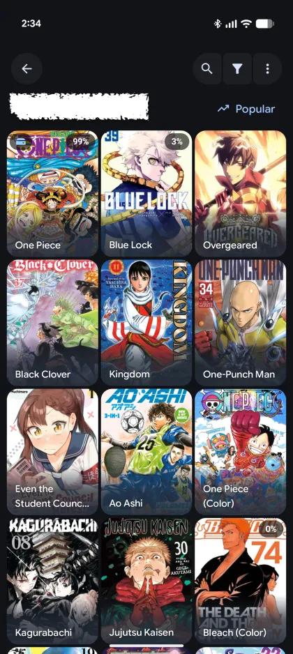
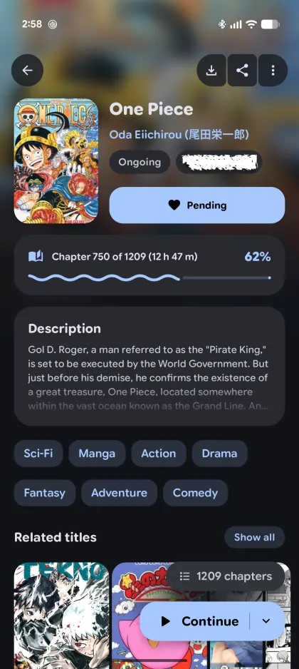
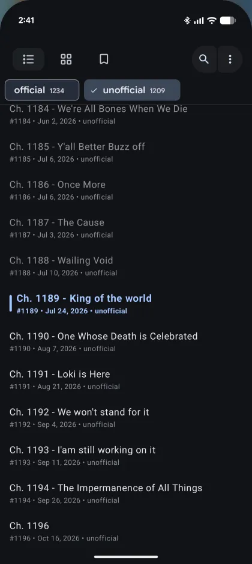
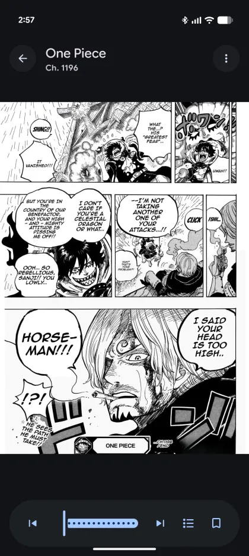
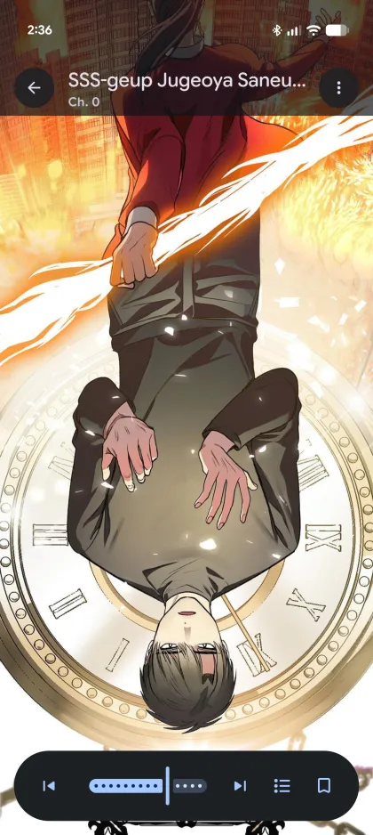
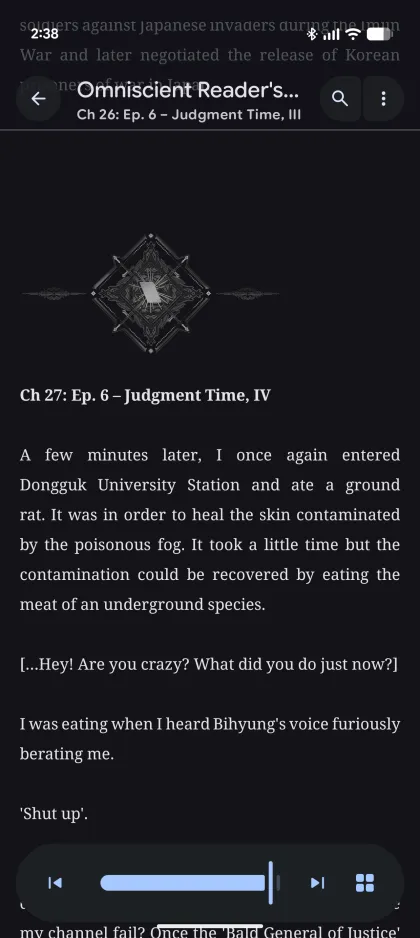

<p align="center">
  
</p>

<h1 align="center">SlopSauce</h1>

<p align="center">
  A lightweight, modern comic and novel reader for Android with a beautiful Material 3 Expressive design. Supports Mihon and LNReader extensions.
</p>

<p align="center">
  <sub>SlopSauce is a fork of <a href="https://github.com/HuzaifaKhalid1311/DropSauce">DropSauce</a> by HuzaifaKhalid1311.</sub>
</p>

<p align="center">
  <a href="https://github.com/RoTatsuLabs/SlopSauce/releases/latest"></a>
  <a href="https://github.com/RoTatsuLabs/SlopSauce/releases"></a>
  <a href="LICENSE"></a>
</p>

<p align="center">
  <a href="https://developer.android.com/"></a>
  <a href="https://kotlinlang.org/"></a>
  <a href="https://developer.android.com/compose"></a>
  <a href="https://m3.material.io/"></a>
</p>

<p align="center">
  <a href="https://github.com/RoTatsuLabs/SlopSauce/releases/latest"><strong>Download APK</strong></a>
  |
  <a href="https://github.com/HuzaifaKhalid1311/DropSauce"><strong>Upstream (DropSauce)</strong></a>
</p>

---

## About

SlopSauce is a free and open-source comic and novel reader for Android, built to feel quick, clean, and comfortable to use with a lot of features

SlopSauce is a personal fork, built for my own use and shared as is. It takes no issues or pull requests, and I give no support, no guarantees, and no promise of updates or fixes.

⭐Please give the repo a star if you like the project. It helps more people find it.🌟

## Screenshots

<p align="center">
  
  
  
  
  
  
  
  
  
</p>

<p align="center">
  <sub>Favorites | Feed | Settings | Source Browsing | Details | Chapters | Manga Reader | Webtoon Reader | Novel Reader</sub>
</p>

## Highlights
- Full novel reading support alongside manga, including offline EPUB file importing.
- Multi-source extension engine supporting LNReader JS plugins and Tsundoku APK extensions.
- Lightweight Android-first experience with a modern, polished interface.
- Rich extension support with library, reading, history, bookmarks, tracking, stats, and settings tools.
- Google Drive sync, local backup/restore, and in-app updates to keep your setup moving with you.
- Supports Kotatsu and Mihon backup restoration alongside google drive sync
- Free and open-source under the GPLv3 license.

<details>
<summary><strong>SlopSauce Exclusive</strong></summary>

- Secret space: a separate library, history, bookmarks and downloads behind a PIN or fingerprint. Hold Incognito in the ⋮ menu to open it. It locks when you leave the app and leaves nothing behind in the main app.
- Telegram backup: send backups to your own Telegram chat with the built-in bot.
- Backup contents: pick what goes into a backup, such as only your library. Restore reads what is inside, and periodic and Telegram backups each keep their own choice.
- Download ahead: queue the next chapters while you read, with a count you set. It stays off in incognito mode.
- Hide favourites: hide titles you already favourited from source lists, in Settings > Appearance.
- Faster downloads: several pages download at once, with a limit per website. Pick how many pages and how many manga download together in Settings > Downloads.
- Download manager: a queue you can reorder, live speed, time left, pause and resume for one or all, and a notification that shows the total.
- Parallel page progress: the progress bar shows each page of the chapter being downloaded, with the ones in progress moving.
- Tracker import: when editing a manga, import the cover, title, description, alternative names, genres, authors, status, content rating and score from a tracker. You choose per field whether to replace, append or fill if empty. Nothing changes until you save.
- Same-title favourites: a title you already favourited from another source gets a badge on its cover in source lists and a note on its details page. Hide favourites is also in the list display options.
- Auto-track favourites: titles you add to favourites are tracked on every tracker you are signed in to, with your reading progress. Only clear matches are linked and the rest wait in a needs-review list. A button tracks the favourites that are not tracked yet. Requests are spaced out and follow each tracker's rate limit.

</details>

<details>
<summary><strong>Features</strong></summary>

- Comfortable manga, webtoon and novel reading experience with configurable reader behavior, haptics, and zoom gestures.
- EPUB novel importing for offline reading.
- Extensive extension ecosystem supporting native extensions, LNReader JS plugins, and Tsundoku APK extensions.
- Reverse tracking integration with a redesigned tracking menu.
- Favorites, history, bookmarks, tracking, stats, and categories to keep your library organized.
- Google Drive sync for library, history, bookmarks, tracking, stats, settings, and covers.
- Local backup and restore system for moving or protecting your setup.
- Material 3 Expressive details page for clear and quick overview
- New onboarding/welcome flow with sync and restore setup.
- Android widgets for continue reading, favorites, and reading stats.
- PDF import support, converting PDFs into readable CBZ chapters.
- App lock with biometric or device credential support.
- Downloads for offline reading when a source supports it.
- In-app updates, with APKs also published through GitHub Releases.

</details>

<details>
<summary><strong>Recent improvements</strong></summary>

- Full novel support with offline EPUB file importing.
- LNReader JS plugin and Tsundoku APK extension support.
- Interactive zoom gestures in novel reading mode.
- Added reverse tracking and refreshed tracking menu design.
- New popup animations across app flows.
- Redesigned list options, filter menu, and progress tracking.
- Minor UI improvements, edge-case crash fixes, and release build cleanups.

</details>

## Star History

<a href="https://www.star-history.com/?repos=rotatsulabs%2Fslopsauce&type=date&releases=&legend=bottom-right">
 <picture>
   <source media="(prefers-color-scheme: dark)" srcset="https://api.star-history.com/chart?repos=rotatsulabs/slopsauce&type=date&theme=dark&legend=bottom-right" />
   <source media="(prefers-color-scheme: light)" srcset="https://api.star-history.com/chart?repos=rotatsulabs/slopsauce&type=date&legend=bottom-right" />
   
 </picture>
</a>

## Install

1. Open the [latest GitHub release](https://github.com/RoTatsuLabs/SlopSauce/releases/latest).
2. Download the newest `SlopSauce` APK.
3. Install it on a compatible Android device.
4. Add your preferred source or extension repository, then start reading.

Android may ask you to allow installs from your browser or file manager. That is normal for APKs downloaded outside the Play Store.

## FAQ

### Does SlopSauce include manga or novels?
> No. SlopSauce does not include built-in content. Sources are provided through external libraries, JS plugins, or repositories added by users.

### Is SlopSauce free?
> Yes. SlopSauce is free and open source under the GPLv3 license.

### How do updates work?
> SlopSauce supports in-app updates, and release APKs are also published on GitHub. You can update from inside the app or install the latest APK from the Releases page.

## Project structure

```plaintext
app/src/main/
├── kotlin/org/koitharu/kotatsu/
│   ├── core/          # Shared database, network, parser, preferences, UI, and utility code
│   ├── main/          # App entry points, main activity, and app-level screens
│   ├── reader/        # Manga and novel reader UI and reading behavior
│   ├── details/       # Manga and novel details, chapters, metadata, and related services
│   ├── explore/       # Browse and discovery screens
│   ├── search/        # Search screens and search flows (with Manga/Novel toggle)
│   ├── favourites/    # Favorites and library-facing flows
│   ├── history/       # Reading history and progress
│   ├── download/      # Offline downloads and download queue
│   ├── extensions/    # Extension browsing, JS plugins, and APK extension management
│   ├── lnreader/      # LNReader JS plugin integration
│   ├── mihon/         # Mihon & Tsundoku APK extension integration
│   ├── backup/        # Local backup and restore
│   ├── sync/          # Sync data, domain, UI, and workers
│   ├── tracker/       # Tracking integrations and reverse tracking
│   ├── widget/        # Android home screen widgets
│   └── settings/      # Settings screens and preferences
└── res/
    ├── drawable*/     # Icons, backgrounds, and app artwork
    ├── layout*/       # XML screens, widgets, and reusable layouts
    ├── mipmap*/       # Launcher icons
    ├── values*/       # Strings, colors, themes, and translations
    └── xml/           # Android XML configuration
```

## Credits

SlopSauce is a fork of [DropSauce](https://github.com/HuzaifaKhalid1311/DropSauce) by HuzaifaKhalid1311, and exists because of the work already done by the open-source Android manga reader community.

Special thanks to the original [Kotatsu](https://github.com/KotatsuApp/Kotatsu) developers, [LNReader](https://github.com/LNReader/lnreader) developers, and the [Mihon](https://github.com/mihonapp/mihon) developers/community for the ideas, code, source ecosystem, and long-running maintenance work that helped shape projects like this.

## License

[](http://www.gnu.org/licenses/gpl-3.0.en.html)

<div align="left">

All programs from the SlopSauce project (a fork of DropSauce) are free, open-source programs under the GPL license. You may copy, distribute, and modify the software as long as you keep track of changes/dates in the source files. Any modifications to the software, including code licensed under the GPL (via a compiler), must also be provided under the GPL license.

</div>

## Disclaimer

<div align="left">

The developer(s) of this application do not have any affiliation with the content providers available. If there is any content, it is provided by external libraries added or imported by users; the application itself does not include any built-in content.

</div>
